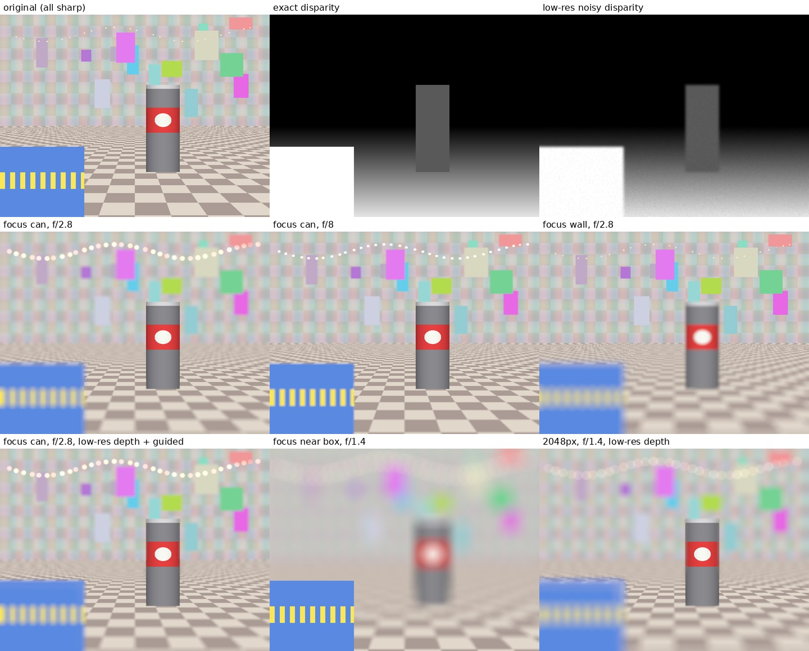

# DepthBokeh：用纯 Swift 实现 iPhone 人像模式的景深效果

这个项目复刻了 iPhone 相机「人像 → ƒ 景深」的效果：取景时可以实时拖动 ƒ 值、点按换对焦点，拍完以后还能重新调景深。

- **BokehCore**：景深算法的 CPU 参考实现 + 每帧的分析（对焦、主体、分层），**纯 Swift**，只依赖 Foundation / Dispatch，不调用 Core Image 或任何现成的模糊滤镜。iOS、macOS、Linux 都能编译。
- **BokehMetal**：同一套算法的 GPU 版（Metal 计算着色器，`BokehShaderSource.swift`），App 里实时预览和拍后编辑都用它。和 CPU 版逐步对比、结果一致（Mac 上 `swift test`）。
- **BokehCamera**：iOS 相机层，用 AVFoundation 同步采集视频帧和深度图，CPU 上分析、GPU 上渲染，直接画到 Metal 视图上。
- **App/**：SwiftUI 界面（取景、ƒ 滑块、点按对焦、快门、拍后编辑），3 个文件。
- **bokeh-cli**：命令行工具，在电脑上用图片和深度图调试算法。



## 在 iPhone 上运行

需要：Xcode 15 或更新版本、iOS 17 以上的真机（模拟器没有摄像头），机型要有**双摄或 LiDAR**（iPhone 11 及以后的绝大多数机型都可以；SE、XR 这类单摄机型不行）。

1. Xcode → New Project → iOS App（Interface 选 SwiftUI），最低部署版本设为 iOS 17。
2. 删掉模板自带的 `ContentView.swift` 和 `<项目名>App.swift`，把本项目 `App/` 下的 3 个文件拖进去。
3. File → Add Package Dependencies… → Add Local…，选择本项目根目录（`DepthBokeh`），把 `BokehCore` 和 `BokehCamera` 两个库加到 App target。
4. Target → Info 里添加两个权限说明：
   - `Privacy - Camera Usage Description`（NSCameraUsageDescription），比如「拍摄带深度信息的照片」
   - `Privacy - Photo Library Additions Usage Description`（NSPhotoLibraryAddUsageDescription），比如「保存虚化后的照片」
5. **Product → Scheme → Edit Scheme → Run → Build Configuration 改成 Release。** 虚化在 GPU 上算，但每帧 CPU 上的分析（对焦、主体种子）是纯 Swift 循环，Debug 模式不开优化会慢很多、更耗电。
6. 选你的 iPhone，运行。
7. （可选，0.5× 超广角要用）把 `DepthAnythingV2SmallF16.mlpackage`（Apple 的 Core ML 版 Depth Anything V2，约 48 MB）拖进 App target。
   没打包的话，第一次切到 0.5× 时会从 Hugging Face（国内先试 hf-mirror.com）下载并在手机上编译。

### 变焦（0.5×–4×，和 DepthBokehCamera 2 一样）

点 0.5 / 1 / 2 / 4 跳过去（预览 0.3 秒平滑变焦），或者左右拖刻度连续调；松手时离数字 ±5% 以内会吸附过去。

| 倍率 | 实际用的相机 | App 裁切 | 深度 |
|---|---|---|---|
| 0.5×–0.99× | 超广角 | 1–1.98× | AI 单目深度 |
| 1×–1.99× | LiDAR（1×） | 1–1.99× | LiDAR |
| 2×–3.99× | 双摄广角（主摄原生 2×） | 1–1.99× | 双摄视差 |
| 4× | 双摄长焦 | 无 | 双摄视差 |

实时深度只在几个倍率点上有（iPhone 17 Pro Max：1×、2×、4×），两个点之间相机停在低的那个点，画面和深度图一起从中间裁。
拖动时只裁当前相机的画面，往小拖超过当前相机 5% 才马上换相机；松手约 0.3 秒后换到这个倍率最合适的相机。
换相机期间保留最后一帧，新相机出了 3 帧并且有深度（最多 0.8 秒）后淡入。路线规划在 `LensCatalog.swift`。

## 实时预览怎么跑、怎么省电

每一帧：

1. **CPU**（`LiveFrameAnalyzer`，深度图分辨率 ≤ 320×240，几毫秒）：对焦稳定、主体太近、相对深度保护、分层位置、主体种子、手机 / 画面是不是在动，得到一份 `FramePlan`。
2. **GPU**（`MetalBokehRenderer`）：相机帧直接当纹理用（`CVMetalTextureCache`，不拷贝），按 `FramePlan` 做缩小、深度对齐、跨帧稳定、主体遮罩、分层圆盘模糊、补洞、合成，写进屏幕要显示的纹理。
3. **显示**（`MetalPreviewView`）：有新帧才画一次；只有点数字平滑变焦（0.3 秒）、换相机淡出（0.2 秒）期间连续刷新。

省电措施（都不影响取景的帧率和清晰度）：

| 情况 | 处理 |
|---|---|
| GPU 上已经有 2 帧没算完（GPU 跟不上） | 丢掉新来的帧（不排队、延迟不累积） |
| 显示 | 有新帧才画，不按屏幕刷新率空转 |
| 人像分割（Vision） | 每秒最多 10 次，用上一次的结果，不拖慢这一帧 |
| 机身发热（`systemPressureState` / 发热状态） | 只在状态行提示「机身发热」，不降帧、不降分辨率 |

画面静止时隔帧处理（15 fps）的开关在 `DepthCameraController.throttleWhenStill`，默认关。

取景界面顶部显示每帧 CPU / GPU 耗时、实际帧率、每秒到了几张新深度（「深度 30/s」，被丢的显示「丢 n」）和机身发热状态。

### 没有新深度的帧（`StaleDepth`）

相机有时某一帧没有送来新深度（晚到、深度帧率比视频低），只能沿用旧的那张。画面里有东西在动时（手在镜头前挥），
旧深度里的手还停在原来的位置：手离开的地方背景一块一块地虚化或清晰，手新移到的地方被当成背景虚化掉、看起来半透明——就是「手有重影」。
所以这些帧不直接用旧深度，而是把**上一帧已经对齐好的深度按画面的运动搬到这一帧**：

1. 和上一帧比颜色，找出变了的地方（没动的地方、手的内部深度都还是对的）；
2. 1/4 分辨率上做块匹配，找到每块是从上一帧哪里移过来的（±48 像素）；
3. 变了的像素在相邻块的运动里挑最吻合的，取上一帧那里的深度；再按这一帧的亮度引导滤波贴边；
4. 新深度来的那一帧，这些被搬过的区域不做时间平滑（不然错的深度会再拖好几帧）。

人像分割的遮罩也总是晚几帧：和算遮罩那一帧的小图比，画面变了的地方不再相信遮罩。
在录好的 S05（拳头在镜头前挥动、深度每 3 帧才有一张新的）上，深度错了一大截的像素从 7.0% 降到 1.3%。
深度输出也改成不丢晚到的数据（`alwaysDiscardsLateDepthData = false`）、关掉防抖，尽量每帧都有新深度。

## 在电脑上调试算法

```bash
swift test                                   # 单元测试；在 Mac 上还会跑 GPU 和 CPU 的逐像素对比（BokehMetalTests）
swift build -c release
.build/release/bokeh-cli in.ppm disparity.pfm out.ppm --f 2.8 --focus 0.6,0.55
```

输入是 8 位 PPM 图像和单通道 PFM 视差图（单位 1/米）。视差图分辨率可以比图像低，工具会自动补洞、上采样并做引导滤波。

### 实时预览模拟（和 App 跑同一份代码）

App 每帧的处理（变焦裁切、对焦稳定、主体太近、双摄相对视差、主体遮罩、人像分割、跨帧稳定、扫镜头检测）都在
`BokehCore/LivePreviewPipeline.swift`，`DepthCameraController` 只负责相机和换镜头。电脑上用
`bokeh-cli --live` 读录好的「相机整帧 + 深度」逐帧跑同一个 pipeline，每帧输出对焦、是否在扫镜头、各步骤耗时：

```bash
echo '{"img":"frame.ppm","depth":"depth.pfm","out":"out.ppm","f":1.4,"crop":1.5,"rel":true,"fx":0.5,"fy":0.5,"tap":true,"t":0}' \
  | .build/release/bokeh-cli --live
```

`crop` 是从相机画面中间裁的倍数（两个深度倍率点之间的数码变焦），`rel` 表示视差是相对值（双摄 / AI），
`reset: true` 模拟换相机，`mask` 可以传人像分割遮罩（PFM，0…1），`maskimg` 是算遮罩那一帧的画面（PPM），
`age` 表示深度是几帧之前的（模拟没有新深度的帧）。

## 算法

完整流程在 `Sources/BokehCore/BokehRenderer.swift`，每一步都有注释。

1. **深度对齐**（`DepthRefiner`）：iPhone 的视差图分辨率低、边缘发糊。先用 pull-push 补洞，再上采样到图像尺寸，最后用彩色图做**引导滤波**，让深度边缘贴合物体轮廓。
2. **虚拟镜头**（`LensParameters`）：模糊半径只和**视差差** Δd = d − d_f（单位 1/米）有关，和真实镜头一样；大视差差时饱和（ƒ1.4 时约为长边的 1%）。对焦面前面有一段 0.25 的全清晰区（系统人像照片里对焦面前面不远的东西都是清晰的），后面只有 0.04。对焦在远处时，前面不远的人和物体只是轻微虚化。
3. **深度分层**：按带符号的模糊半径把画面切成十几层，靠近对焦面的地方切得更密。每个像素按线性权重分到相邻的两层，避免出现断层。
4. **圆盘模糊**：真实镜头的焦外是边缘清晰的**圆盘**，不是高斯。实现上用逐行前缀和，每个像素只要 O(r) 的计算量；圆盘边缘有亚像素级抗锯齿。半径大的层先降采样再模糊，计算量大约降到 1/q³。没有数据的 32×32 分块直接跳过。
5. **遮挡合成**：
   - 背景层从远到近用 over 方式合成，这样清晰的主体能完全挡住后面虚化的背景，边缘不会有光晕；
   - 被前景挡住、背景里缺数据的区域，用 **pull-push 从周围背景外推**来补。iPhone 前景虚化时物体边缘的「涂抹感」，就是这一步留下的痕迹；
   - 前景层用加法累积，再整体盖到背景上，前景的虚化会自然地向外扩散、边缘变成半透明。
6. **焦外光斑**：传感器上过曝的小亮点（灯珠、反光）在模糊前先提亮，模糊后才会变成明亮的光斑，而不是灰蒙蒙一片。大块的白色区域和锐化造成的边缘亮线不会被当成高光。

## CPU 参考实现的性能（在 2 核的 Linux 云主机上实测，Release 构建）

| 场景 | 深度处理 | 渲染 |
|---|---|---|
| 实时预览 480×360，ƒ2.8 | 25 ms | 约 50 ms |
| 照片 2048×1536，ƒ2.8 | 约 500 ms | 约 1.4 s |
| 照片 2048×1536，ƒ1.4 | 约 500 ms | 约 1.0 s |

App 里实时预览和拍后编辑已经改用 GPU 版；CPU 版留作参考实现（测试对比、电脑上调试、没有 Metal 时的后备）。
GPU 版在 Mac 上的耗时 `swift test` 会打印（`[性能]` 那一行），手机上的以取景界面顶部显示的为准。

## 已知限制与可以改进的地方

- **物体边缘**：深度图在边缘处是「混合像素」，过渡区可能出现一圈轻微的暗边或半虚化带。可以用 Vision 的人像分割（`VNGeneratePersonSegmentationRequest`）或主体分割（`VNGenerateForegroundInstanceMaskRequest`）先修正边缘处的深度。iPhone 系统相机也是这么做的。
- **前景背后的内容是猜出来的**：摄像头没拍到被挡住的部分，只能外推。前景虚化越强，这一点越明显。
- **GPU 版和 CPU 版要一起改**：改算法时两边都要改，`swift test` 在 Mac 上会逐步对比（低分辨率原图、对齐后的深度、主体遮罩、虚化、虚化程度、输出）。
- **双摄视差是「相对精度」**（`depthDataAccuracy == .relative`），算出来的绝对虚化量不精确。可以把 `virtualFocalLength` 当成「虚化强度」来调。
- **单摄机型**：没有硬件深度。可以换成 Core ML 的单目深度模型（比如 Depth Anything、Apple 的 Depth Pro）来输出视差图，后面的流程完全一样。
- 处理时统一转成 sRGB，HEIC 照片的 P3 广色域会丢失；前置原深感摄像头没有接入（它的方向和镜像需要另外处理）。
